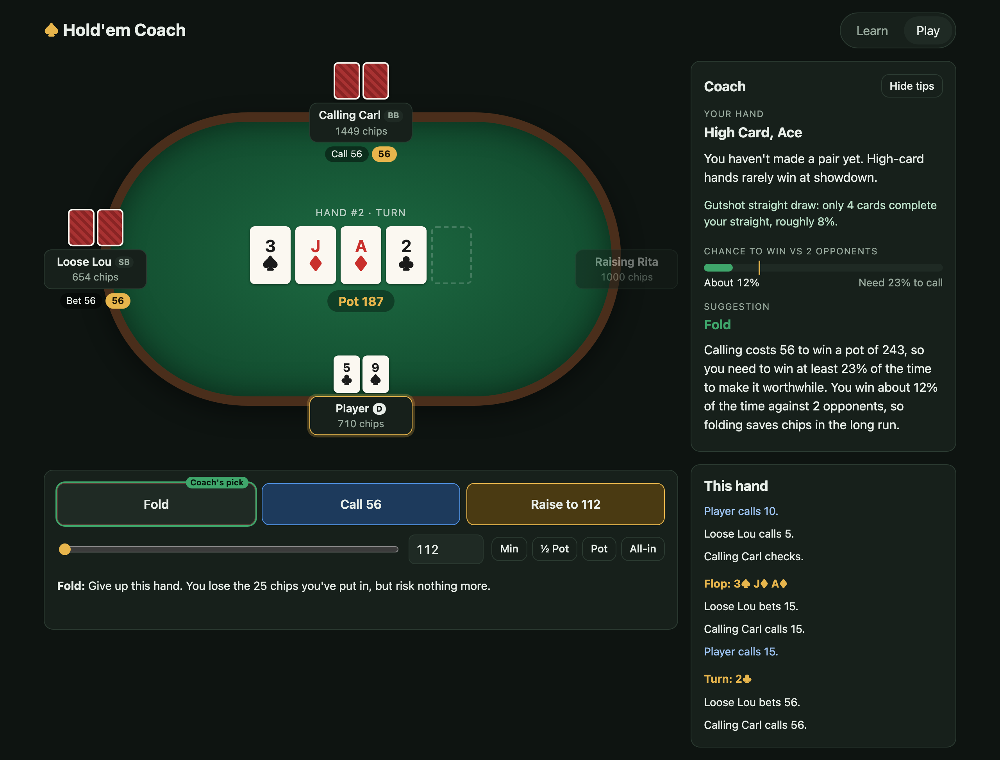

# Hold'em Coach

[](https://github.com/KevST14/holdem-coach/actions/workflows/tests.yml)
[](LICENSE)


Learn Texas Hold'em from scratch, then practice against computer opponents with a coach that explains every decision.

- **Learn**: how a hand plays out, hand rankings with examples, and a glossary.
- **Play**: a full no-limit Hold'em table against 1-5 bots with different personalities. The coach shows what your hand is, any draws, your chance of winning, the price of calling, and a suggested move with the reasoning.



## How the coach works

Every time it's your turn, the coach ([`coach.py`](backend/src/holdem/coach.py)) goes through the same four steps.

**1. Name your hand.** Before the flop it names your two cards ("Ace-King suited", "Pocket Nines") and scores them with Bill Chen's formula: points for the higher card, doubled for a pair, plus 2 if they're suited, minus a penalty for the gap between them. The score picks the tip, from "one of the best starting hands" (12 or more) down to "most experienced players fold this" (below 7). After the flop, the evaluator finds your best five cards and the coach says what kind of hand it is, such as an overpair, top pair, or a pair on the board that everyone shares.

**2. Spot draws.** A flush draw is four cards of one suit, at least one of them yours. For straights it counts how many ranks would complete one using a card in your hand: two or more is an open-ended draw (8 cards help), one is a gutshot (4 cards). The odds use the rule of 4 and 2: multiply the cards that help by 4 on the flop, or by 2 on the turn.

**3. Estimate the chance to win.** [`equity.py`](backend/src/holdem/equity.py) deals out the cards nobody can see yet, the rest of the board and every opponent's hand, 400 times and counts how often you'd win. A tie counts as your share of the pot. Opponents are treated as holding random cards, so it doesn't read anything into how they've bet.

**4. Weigh it against the price.** When you're facing a bet, the price is the share of the final pot you'd be paying for. Calling 56 into a pot of 187 means putting in 56 of 243, so you need to win at least 23% of the time. Then:

| Situation | Suggestion |
|---|---|
| Nobody has bet, strong hand | Bet |
| Nobody has bet, anything else | Check |
| Facing a bet, very strong hand | Raise |
| Facing a bet, chance to win at least the price | Call |
| Facing a bet, anything else | Fold |

"Strong" means 1.5 times an average hand's chance for that many players, and "very strong" means 1.8 times. Against three opponents an average hand wins 25% of the time, so strong is about 38% and very strong is 45%.

The bots ([`bots.py`](backend/src/holdem/bots.py)) use the same recipe with a quicker estimate (200 deals) and a personality that nudges it. *Looseness* is added to their chance to win before they decide, *aggression* is how often they bet a strong hand, and *bluff* is how often they bet a weak one. Calling Carl's looseness of 0.25 is why he almost never folds.

## Layout

```
backend/   Python: game engine, bots, coach, FastAPI server
  src/holdem/
    cards.py       cards and decks
    evaluator.py   best five-card hand from 5-7 cards
    pots.py        main pot and side pots
    game.py        the table: blinds, betting rounds, all-ins, showdown
    equity.py      Monte Carlo win-chance estimates
    bots.py        computer opponents
    coach.py       beginner explanations and suggestions
    learn.py       lesson content
    api/           HTTP API (in-memory game sessions)
  tests/
frontend/  React + TypeScript + Vite
```

## Running it

Requires Python 3.11+ with [uv](https://docs.astral.sh/uv/), and Node 20+.

```bash
cd backend && uv sync && uv run uvicorn holdem.api.app:app --reload --port 8000
```

```bash
cd frontend && npm install && npm run dev
```

Then open http://localhost:5173. The dev server forwards `/api` to the backend on port 8000.

## Tests

```bash
cd backend && uv run pytest
```

```bash
cd frontend && npm run build
```

Games live in memory, so restarting the backend ends any game in progress.
